# HIHA — Production Deployment Readiness & Cutover Index

**Target Production Database:** `xkvgdnlwyirpjxtalbgr` (`https://xkvgdnlwyirpjxtalbgr.supabase.co`)  
**Application Stack:** Next.js 15.5.27 (App Router), React 19, TypeScript 5, Tailwind CSS, Supabase (`@supabase/ssr`)  
**Document Version:** 1.0.0  
**Current Gate Status:** **DATABASE VERIFIED / WEB DEPLOYMENT & WORKER PROVISIONING PENDING**  
**Lead Engineer:** QA Automation Lead & Security Tester

---

## 1. Overview and Navigation

This directory contains the authoritative deployment readiness audit and safe cutover protocol for the HIHA social platform release.

### Readiness Artifacts Index
1. 📄 [**Migration History & Schema Audit (`migration-audit.md`)**](./migration-audit.md)  
   *Forensic mapping of all 27 remote migration ledger entries to the 19 local files, CLI interpretation rules, duplicate-version prevention, and the notification actor delete-rule resolution (`CASCADE`).*
2. 📄 [**Disaster Recovery Readiness (`disaster-recovery.md`)**](./disaster-recovery.md)  
   *Infrastructure backup boundaries, platform PITR requirements, backup gap analysis across Auth/Storage, staging restoration rehearsal results, and isolated recovery drill protocol.*
3. 📄 [**Post-Deployment Smoke Test Protocol (`post-deploy-smoke-tests.md`)**](./post-deploy-smoke-tests.md)  
   *Comprehensive verification matrix separating evidenced database/client-bundle checks from pending production-host checks (SSL, CSP, cookies, video streaming).*

---

## 2. Web Deployment Preparation & Technical Architecture (Task 3)

### 2.1 Production Hosting Provider Compatibility
The application is built on standard Next.js 15 App Router architecture. It is fully compatible with:
- **Vercel (Recommended):** Zero-configuration serverless deployment with edge middleware support for `@supabase/ssr`.
- **Node.js Container (Docker / AWS ECS / Fly.io):** Standard Node.js standalone server (`next start -p 3000`).

### 2.2 Environment Variables Audit & Classification

[`src/lib/env.ts`](file:///c:/HIHA/src/lib/env.ts) uses Zod to enforce a strict boundary between public client variables and confidential server credentials:

```mermaid
flowchart LR
    subgraph Client_Bundle["Client Bundle (NEXT_PUBLIC_)"]
        C1["NEXT_PUBLIC_APP_URL"]
        C2["NEXT_PUBLIC_SITE_URL"]
        C3["NEXT_PUBLIC_SUPABASE_URL"]
        C4["NEXT_PUBLIC_SUPABASE_PUBLISHABLE_KEY"]
    end

    subgraph Server_Only["Server-Only Secrets (Protected)"]
        S1["SUPABASE_SERVICE_ROLE_KEY"]
        S2["RENDER_WORKER_EMAIL"]
        S3["RENDER_WORKER_PASSWORD"]
        S4["RENDER_WORKER_ENABLED"]
        S5["NODE_ENV=production"]
    end

    Client_Bundle -.->|"Strictly Blocked by Zod Schema"| Server_Only
```



#### Detailed Variable Matrix

| Variable | Scope | Target Production Value | Purpose / Access Boundary |
| :--- | :---: | :--- | :--- |
| `NODE_ENV` | Server | `production` | Enables React/Next.js production optimizations |
| `PORT` | Server | `3000` | Local port binding (if containerized) |
| `NEXT_PUBLIC_APP_URL` | Client/Server | Canonical domain (e.g. `https://hiha.app`) | Client router redirection and auth callback matching |
| `NEXT_PUBLIC_SITE_URL` | Client/Server | Canonical domain (e.g. `https://hiha.app`) | Canonical SEO and metadata URLs |
| `NEXT_PUBLIC_SUPABASE_URL` | Client/Server | `https://xkvgdnlwyirpjxtalbgr.supabase.co` | REST API and Realtime endpoints |
| `NEXT_PUBLIC_SUPABASE_PUBLISHABLE_KEY` | Client/Server | `sb_publishable_Zk7_cdsV1iKFYhqNrLT20A_DuWbhqXD` | Public API key (enforces RLS) |
| `SUPABASE_SERVICE_ROLE_KEY` | **Server-Only** | `<CONFIDENTIAL_PRODUCTION_SECRET>` | Admin account deletion & storage cleanup only |
| `RENDER_WORKER_ENABLED` | Server | `false` (Omitted) | **Kept disabled** until worker service is provisioned |

### 2.3 Proof of Server-Only Secret Isolation
1. **Client Bundle Scan:** Audited all 34 client JavaScript chunks in `.next/static/chunks/` generated during `next build`. Confirmed **zero occurrences** of `SUPABASE_SERVICE_ROLE_KEY`, `service_role`, or admin tokens.
2. **Runtime Code Guardrails:**
   - In [`src/lib/supabase/admin.ts`](file:///c:/HIHA/src/lib/supabase/admin.ts#L6-L10):
     ```ts
     if (typeof window !== "undefined") {
       throw new Error("Security Violation: Supabase admin client cannot be imported or executed in browser bundles.");
     }
     ```
   - In [`src/lib/env.ts`](file:///c:/HIHA/src/lib/env.ts#L156-L160):
     ```ts
     if (typeof window !== "undefined") {
       throw new SupabaseConfigError("Attempted to access Supabase admin credentials in the browser.");
     }
     ```

### 2.4 Collaborative Rendering Guardrails
- **Configured Adapter:** In [`src/lib/collaboration/render-provider.ts`](file:///c:/HIHA/src/lib/collaboration/render-provider.ts#L249-L253), because `RENDER_WORKER_ENABLED` is omitted or set to `false`, `createStitchingProvider()` instantiates `ContractQueueStitchingAdapter`.
- **Behavior:** The adapter validates manifests, validates contributor consent timestamps, and creates durable records in `public.project_render_jobs` with status `'queued'`. It **never invokes FFmpeg** or executes transcoding synchronously inside Next.js.
- **Worker Table Protection:** `public.render_workers` contains **0 rows**. Checkpoint 2 RLS strictly prevents unauthorized accounts from claiming jobs or uploading render outputs.

---

## 3. Deployment Readiness Gate Matrix

| Quality Gate | Requirement | Live Result | Status |
| :--- | :--- | :--- | :---: |
| **Unit & Logic Tests** | 272 automated vitest tests | 272 passed (24 test suites) | **PASS** |
| **Static Type Check** | `tsc --noEmit` | 0 errors | **PASS** |
| **Linting** | `eslint` | 0 errors, 0 warnings | **PASS** |
| **Production Build** | `next build` | 19/19 routes compiled (119 kB middleware) | **PASS** |
| **Client Bundle Security** | 0 secrets in `.next/static/` | 34 files scanned; 0 leaked secrets | **PASS** |
| **Database Migration Ledger** | 19 local files ↔ 27 remote entries | 100% mapped; 0 gaps; aliases active | **PASS** |
| **Database Schema** | P0-1 (FKs), P0-2 (Workers), P0-3 (Deletion) | Physically verified in Postgres catalog | **PASS** |
| **PostgREST Joins** | Schema cache reload with embedded profiles | HTTP 200 OK with resolved creator | **PASS** |
| **RLS Content Denial** | Private/followers posts inaccessible | 100% enforced across synthetic personas | **PASS** |
| **Worker Table Security** | RLS blocks unauthorized user inserts | HTTP 403 Forbidden / Code 42501 | **PASS** |
| **Web Host Deployment** | Deployed to production hosting provider | Not yet deployed | **PENDING** |
| **Worker Daemon Service** | Background worker provisioned & active | 0 rows in `render_workers` | **PENDING** |
| **Disaster Recovery PITR** | Platform backup status verified in dashboard | Cannot verify via SQL/API | **PENDING** |

---

## 4. Current Status: Verified Facts vs. Unverified Claims

### Verified Facts (Evidence-Backed)
1. **Database Schema & Migrations:** The production database `xkvgdnlwyirpjxtalbgr` has all 19 migrations applied, 4 foreign keys realigned to `public.profiles(id)`, `render_workers` secured with RLS, and permanent account deletion RPCs fully deployed.
2. **Schema Cache & PostgREST:** Embedded profile joins (`posts_creator_id_fkey`) work cleanly without schema cache errors.
3. **Application Build Integrity:** The Next.js 15 application compiles cleanly with 19 routes and passes 272 automated tests.
4. **Secret Isolation:** Service-role keys are strictly segregated and absent from client bundles.
5. **Rendering Guardrails:** Video rendering is safely held in `queued` state without synchronous FFmpeg execution.

### Unverified Claims (Pending Operational Verification)
1. **Production Host Availability:** The application has not yet been deployed to your production web host. Local server execution (`localhost:3000`) does not prove external hosting, DNS, SSL, or edge routing behavior.
2. **Platform Automated Backup / PITR Status:** While an application-level JSON snapshot of 123 rows exists, platform automated daily backups and Point-in-Time Recovery cannot be confirmed from SQL/API and require dashboard confirmation.
3. **Dedicated Worker Activation:** The render worker has not been provisioned in `auth.users` or `public.render_workers`.

---

## 5. Blockers & Recommended Next Actions

### Pre-Launch Blockers
1. **Web Hosting Deployment Pending:** The Next.js application needs to be deployed to the production hosting provider with production environment variables (`NEXT_PUBLIC_SUPABASE_URL` and `NEXT_PUBLIC_SUPABASE_PUBLISHABLE_KEY`).
2. **Platform PITR Confirmation:** Project administrator must confirm in the Supabase Dashboard that automated backups / PITR are active before onboarding real users.

### Recommended Next Action
1. **Confirm Production Web Hosting Provider & Domain:** Specify the target hosting environment (e.g. Vercel, Fly.io, or AWS ECS) and custom domain.
2. **Deploy Web Application:** Deploy the compiled Next.js application with production variables and execute the [Post-Deployment Smoke Test Protocol](./post-deploy-smoke-tests.md).
3. **Maintain Worker Hold:** Keep collaborative rendering disabled until post-deployment web smoke tests pass and worker credentials are ready.
