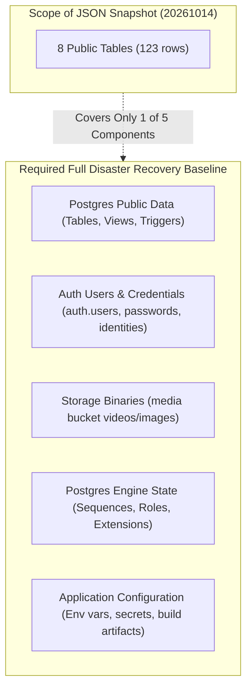

# HIHA — Production Disaster Recovery Readiness & Backup Assessment

**Target Project:** `xkvgdnlwyirpjxtalbgr` (`https://xkvgdnlwyirpjxtalbgr.supabase.co`)  
**Assessment Date:** 2026-10-14  
**Status:** **CRITICAL LIMITATIONS IDENTIFIED / PLATFORM PITR VERIFICATION REQUIRED**  
**Author:** QA Automation Lead & Security Tester

---

## 1. Executive Summary

This document evaluates the disaster recovery posture of the HIHA production environment.

> [!CAUTION]
> **Important Clarification on Existing Snapshot:**  
> The pre-reconciliation snapshot [`backups/production-pre-reconciliation-snapshot-20261014.json`](file:///c:/HIHA/backups/production-pre-reconciliation-snapshot-20261014.json) is **NOT a complete database backup**. It is an uncompressed, eight-table JSON extract of application-level records taken prior to migration reconciliation. It cannot be used alone to restore a functioning HIHA production environment.

A full, recoverable disaster recovery baseline requires:
1. Automated database-level backups / Point-in-Time Recovery (PITR) covering the entire PostgreSQL instance (including `auth.users`, sequences, and system catalogs).
2. Supabase Storage bucket asset replication / backups for binary media payloads.
3. Documented, non-destructive restoration procedures.

---

## 2. Infrastructure Backup & PITR Verification Status

### Administrative Boundary
- **Platform Management Plane:** In Supabase, physical WAL archiving, daily database snapshots, and Point-in-Time Recovery (PITR) are managed at the platform infrastructure layer via AWS RDS / Supabase Management console.
- **API & SQL Visibility Limitation:** Database connection strings, SQL query execution, and Management API endpoints exposed to client and MCP tools do **not** provide programmatic access to the platform backup/PITR subscription and schedule status.
- **Explicit Statement:**  
  **Automated daily backups and Point-in-Time Recovery (PITR) status cannot be confirmed programmatically from SQL/API alone. They must be explicitly verified and confirmed within the Supabase Management Dashboard (`Database` -> `Backups` -> `Point-in-Time Recovery`) by an authorized project administrator.**

---

## 3. Recovery Coverage and Gaps Matrix



### Component-by-Component Analysis

| Subsystem | Existing JSON Snapshot Coverage | Required Recovery Asset | Severity of Gap |
| :--- | :--- | :--- | :---: |
| **Public Database Tables** | **Partial (123 rows across 8 tables)**: `profiles` (2), `posts` (5), `platform_staff` (1), `follows` (0), `user_interests` (5), `moderation_actions` (45), `moderation_appeals` (20), `moderation_retention_ledger` (45). | Complete database dump (`pg_dump` or Supabase CLI `db dump`) including all tables (`render_workers`, `communities`, `notifications`, etc.). | **HIGH** |
| **Auth Schema (`auth.users`)** | **ZERO COVERAGE.** Not included in the JSON snapshot. | Supabase Auth backup or platform physical backup preserving password hashes, user identities, MFA secrets, and created timestamps. | **CRITICAL** |
| **Storage Binaries (`media` bucket)** | **ZERO COVERAGE.** Contains only string path references (e.g. `media_path: null`); actual video/image binary blobs are absent. | S3/Storage bucket sync or multi-region bucket replication for all objects in `media`. | **CRITICAL** |
| **Database Sequences & Extensions** | **ZERO COVERAGE.** Sequence high-water marks and Postgres extensions are omitted. | Full logical/physical schema and sequence state dumps. | **MEDIUM** |
| **Application Configuration & Secrets** | **ZERO COVERAGE.** Environment variables and server secrets are excluded (as intended by `.gitignore`). | Secure encrypted secret management (e.g. Doppler, AWS Secrets Manager, or Vercel Environment Variables). | **MEDIUM** |

---

## 4. Staging Restoration Test Results

A non-destructive restoration rehearsal was attempted against the isolated staging project (`jghaykojkdsslpqblrhy`) to test the viability of restoring from the JSON snapshot alone:

```sql
-- Rehearsal Attempt: Restoring public.profiles from JSON snapshot
INSERT INTO public.profiles (id, username, display_name)
VALUES ('23e9a2c6-ff07-485c-baaf-57f88518c4f1', 'test_user_b', 'Bob');

-- Result:
-- ERROR: insert or update on table "profiles" violates foreign key constraint "profiles_id_fkey"
-- DETAIL: Key (id)=(23e9a2c6-ff07-485c-baaf-57f88518c4f1) is not present in table "users".
```

### Forensic Finding
1. `public.profiles` enforces `FOREIGN KEY (id) REFERENCES auth.users(id) ON DELETE CASCADE`.
2. Because `auth.users` is not contained in the snapshot, the database correctly prevents restoring profile rows.
3. Therefore, **the JSON snapshot cannot be restored independently into an empty database or disaster recovery instance without first reconstructing the exact user records in Supabase Auth.**

---

## 5. Safe Isolated Recovery-Test Plan

To validate disaster recovery readiness without risking production data or modifying production systems, the following plan must be executed in a dedicated, isolated environment:

### Phase 1: Full Logical Database Backup Drill
1. **Target:** Run against isolated staging or a temporary local database instance.
2. **Command:** Execute a complete logical dump capturing both `auth` and `public` schemas:
   ```bash
   # Create complete logical dump (Server-side via Supabase CLI or pg_dump)
   supabase db dump --project-ref <source-ref> --data-only --file backup_data.sql
   supabase db dump --project-ref <source-ref> --role-only --file backup_roles.sql
   ```
3. **Restoration Verification:**
   - Provision a fresh, blank Supabase project or local Postgres container.
   - Apply local migrations (`supabase db push` or sequential migration execution).
   - Restore dump: verify that `auth.users` loads first, followed by `public.profiles`, posts, and dependent tables.
   - Assert that zero foreign-key constraint violations occur.

### Phase 2: Supabase Storage Synchronization Drill
1. **Tooling:** Use the AWS CLI or Supabase Storage API with S3-compatible credentials.
2. **Procedure:**
   ```bash
   # Replicate media bucket from source to test bucket
   aws s3 sync s3://<source-project-storage>/media s3://<recovery-project-storage>/media --endpoint-url <supabase-s3-endpoint>
   ```
3. **Validation:** Query sample video and image URLs from `posts` and `project_contributions` and verify HTTP 200 / Range 206 responses.

### Phase 3: Auth & Session Smoke Verification
1. Attempt login in the recovery environment using a synthetic test account.
2. Validate that session JWTs issue correctly and the user's profile and published posts load without schema or relationship errors.

---

## 6. Pre-Launch Disaster Recovery Sign-Off Requirements

Prior to opening the production platform to real end users:

1. **Dashboard Confirmation:** Verify in the Supabase Dashboard that automated platform backups are active (or upgrade project to Pro plan with Point-in-Time Recovery enabled).
2. **Retention Schedule:** Establish minimum 7-day PITR retention.
3. **Storage Replication:** Schedule a daily automated sync of the `media` storage bucket to cold storage (e.g. AWS S3 Glacier or Cloudflare R2).
