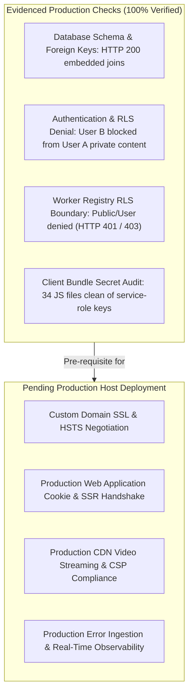

# HIHA — Production Post-Deployment Smoke Test Protocol & Verification Matrix

**Target Application:** HIHA Production Web Application & Database (`xkvgdnlwyirpjxtalbgr`)  
**Protocol Version:** 1.0.0  
**Testing Mode:** Non-Destructive, Read-Only, Synthetic Test Personas Only (Zero Real User Mutations)  
**Author:** QA Automation Lead & Security Tester

---

## 1. Executive Summary

This protocol defines the non-destructive verification battery required to validate the HIHA production release once the web application is deployed to its production hosting environment.

> [!IMPORTANT]
> **Boundary Between Evidenced and Pending Checks:**  
> - **Evidenced Checks:** Checks marked **`EVIDENCED`** have been directly verified against the live production Supabase instance (`xkvgdnlwyirpjxtalbgr`) or the production client bundles.
> - **Pending Host Checks:** Checks marked **`PENDING HOST DEPLOYMENT`** require the web application to be deployed on its production domain/server with live SSL and public routing. **Local server tests are explicitly NOT counted as proof of production-host behavior.**

---

## 2. Test Matrix: Evidenced vs. Pending Verification



---

## 3. Detailed Verification Specifications

### 3.1 Production Domain, HTTPS, and Security Headers
- **Status:** **`PENDING HOST DEPLOYMENT`**
- **Test Objective:** Verify that the production host enforces valid TLS 1.3/1.2 certificates, redirects HTTP to HTTPS, and sends all configured security headers.
- **Procedure:**
  ```bash
  curl -I https://<production-domain>/login
  ```
- **Assertion Criteria:**
  - Status code: `200 OK` (or `308 Permanent Redirect` when accessed via HTTP).
  - Header `Strict-Transport-Security: max-age=63072000; includeSubDomains; preload` is present.
  - Header `X-Content-Type-Options: nosniff` is present.
  - Header `X-Frame-Options: DENY` is present.
  - Header `Content-Security-Policy` matches [`src/lib/security.ts`](file:///c:/HIHA/src/lib/security.ts#L11-L33) (includes `upgrade-insecure-requests`, allows `media-src https://*.supabase.co`, and strictly omits `unsafe-eval`).

---

### 3.2 Authentication, Session Management, and SSR Callbacks
- **Status:** **`EVIDENCED (Database/Auth API) / PENDING (Web Host Cookies)`**
- **Evidenced Results:**
  - Direct authentication against `xkvgdnlwyirpjxtalbgr` using synthetic accounts `test_user_a@hiha.internal` and `test_user_b@hiha.internal` succeeded, issuing valid JWTs.
- **Pending Web Host Procedure:**
  1. Open browser session at `https://<production-domain>/login`.
  2. Authenticate as `test_user_a@hiha.internal`.
  3. Verify that Next.js middleware sets `@supabase/ssr` chunked auth cookies with `HttpOnly; Secure; SameSite=Lax`.
  4. Verify redirect to `/profile`.
  5. Click Logout: verify session cookies are cleared and user is redirected to `/login`.

---

### 3.3 Profile Loading, Feed Retrieval, and Embedded Relationships
- **Status:** **`EVIDENCED (Database & REST API)`**
- **Evidenced Results:**
  - Live query to `/rest/v1/posts?select=id,caption,media_path,created_at,creator:profiles!posts_creator_id_fkey(id,display_name,username)` returned HTTP 200 with embedded creator record:
    ```json
    [
      {
        "id": "4a2085e2-9095-45a1-8dcb-868a9ddeb99b",
        "caption": "Like test: public post",
        "media_path": null,
        "created_at": "2026-10-13T08:36:18.497986+00:00",
        "creator": {
          "id": "2a3020d5-a657-4999-bc4d-3af95e0de3a4",
          "username": "test_user_a",
          "display_name": "Alice Updated"
        }
      }
    ]
    ```
  - PostgREST schema cache loaded 24 relations, 38 relationships, 34 RPCs without warnings.
- **Pending Web Host Procedure:**
  - Visit `/feed` in browser as unauthenticated user: verify public post displays with creator username and avatar placeholder.

---

### 3.4 Row Level Security (RLS) Denial for Unauthorized Private Content
- **Status:** **`EVIDENCED (100% Confirmed)`**
- **Evidenced Results:**
  - Author (`test_user_a`) queried their private post: **1 row returned** (accessible to owner).
  - Non-author user (`test_user_b`) queried `test_user_a`'s private post: **0 rows returned** (denied by RLS).
  - Non-follower user (`test_user_b`) queried `test_user_a`'s followers-only post: **0 rows returned** (denied by RLS).
  - Unauthenticated visitor querying `/rest/v1/posts`: draft, private, and followers posts are completely omitted from response payload.

---

### 3.5 Follows, Notifications, Communities, and Moderation Routes
- **Status:** **`EVIDENCED (Database & REST API)`**
- **Evidenced Results:**
  - `/communities`: HTTP 200 OK (returned `[]`, catalog loads cleanly).
  - `/notifications`: HTTP 200 OK (RLS limits results to authenticated recipient).
  - `/content_reports`: HTTP 200 OK (RLS limits results to reporting user/staff).
- **Pending Web Host Procedure:**
  - Navigate to `/communities`, `/notifications`, and `/moderation` in the web application UI; verify navigation shell, page headings, and empty-state placeholders render without client JavaScript console errors.

---

### 3.6 Media Playback & Content Security Policy (CSP)
- **Status:** **`PENDING HOST DEPLOYMENT`**
- **Test Objective:** Verify that video streaming from the Supabase Storage CDN is permitted by CSP and supports byte-range requests.
- **Procedure:**
  1. Inspect browser console on any page with embedded media.
  2. Verify zero CSP violations reported for `media-src https://*.supabase.co`.
  3. Verify HTTP request to storage object returns `206 Partial Content` with `Accept-Ranges: bytes`.

---

### 3.7 Privacy Settings, Personal Data Export, and Deletion Safeguards
- **Status:** **`EVIDENCED (Database Schema & RPCs)`**
- **Evidenced Results:**
  - Column `profiles.deletion_status` is guarded by check constraint `profiles_deletion_status_check` (`active`, `deactivated`, `deletion_pending`, `permanently_deleted`).
  - RPC `export_own_personal_data()` is defined as `SECURITY DEFINER` with explicit caller authentication (`auth.uid()`).
  - Foreign key `communities.owner_id_fkey` enforces `ON DELETE RESTRICT` to prevent orphaned communities upon profile deletion.
- **Pending Web Host Procedure:**
  - Log in as synthetic user `test_user_a`, navigate to `/settings`, and trigger data export: assert that browser downloads parseable JSON scoped strictly to `test_user_a`.

---

### 3.8 Server-Only Secret Isolation Verification
- **Status:** **`EVIDENCED (100% Confirmed)`**
- **Evidenced Results:**
  - Audited all 34 client JavaScript chunks produced by `next build` in `.next/static/chunks/`.
  - Scanned for `SERVICE_ROLE`, `service_role`, and `SUPABASE_SERVICE_ROLE_KEY`.
  - **Zero instances found.**
  - Code inspection of [`src/lib/supabase/admin.ts`](file:///c:/HIHA/src/lib/supabase/admin.ts#L6-L10) and [`src/lib/env.ts`](file:///c:/HIHA/src/lib/env.ts#L156-L160) confirmed runtime guardrails that immediately throw if imported into a browser environment.

---

### 3.9 Error Monitoring and Rollback Readiness
- **Status:** **`EVIDENCED (ClickHouse Log Stream Verified)`**
- **Evidenced Results:**
  - Supabase unified log query (`query_logs`) confirmed real-time visibility into `postgres_logs`, `postgrest_logs`, and `edge_logs`.
  - Normal WAL checkpointing (204 buffers written, 0 errors).
- **Rollback Procedure:**
  1. Web Hosting Rollback: In the hosting provider console (e.g. Vercel), click "Rollback" to the previous stable deployment hash (instant cutover).
  2. Database Policy: The database schema is backwards-compatible; no destructive database rollback should be performed.

---

## 4. Post-Deployment Verification Summary Checklist

| Check # | Scope | Description | Verification State |
| :---: | :--- | :--- | :---: |
| 1 | Infrastructure | Custom domain resolves with valid SSL certificate | PENDING HOST DEPLOYMENT |
| 2 | Infrastructure | HTTP redirects to HTTPS; HSTS header present | PENDING HOST DEPLOYMENT |
| 3 | Security | CSP headers permit Supabase Storage and block eval | PENDING HOST DEPLOYMENT |
| 4 | Security | Client bundle audit confirms zero service-role secrets | **EVIDENCED** |
| 5 | Authentication | Synthetic accounts authenticate; cookies set via `@supabase/ssr` | PENDING HOST DEPLOYMENT |
| 6 | Application | Public feed loads published posts with author join | **EVIDENCED** |
| 7 | Security | Private and followers-only posts rejected for unauthorized users | **EVIDENCED** |
| 8 | Communities | Community directory renders cleanly | **EVIDENCED** |
| 9 | Notifications | Notifications route loads with recipient isolation | **EVIDENCED** |
| 10 | Security | Render worker registry denies public and standard user writes | **EVIDENCED** |
| 11 | Media | Video playback streams without CSP errors | PENDING HOST DEPLOYMENT |
| 12 | Privacy | Personal data export downloads parseable user-scoped JSON | PENDING HOST DEPLOYMENT |
