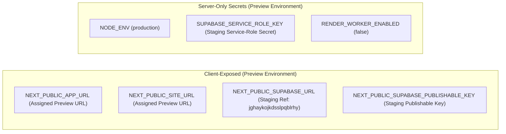

# HIHA — Vercel Preview Deployment Report (Stage 1)

**Repository:** `C:\HIHA`  
**Hosting Provider:** Vercel  
**Target Environment:** Vercel Preview (Staging Backend Only)  
**Target Supabase Project:** `jghaykojkdsslpqblrhy` (`https://jghaykojkdsslpqblrhy.supabase.co`)  
**Report Date:** 2026-10-14  
**Status:** **BLOCKED PENDING VERCEL CLI AUTHENTICATION & PROJECT LINKING**  
**Author:** QA Automation Lead & Security Tester

---

## 1. Executive Summary

This report establishes the repository audit, build verification, and deployment readiness for **Stage 1: Vercel Preview Deployment**.

In strict compliance with safety rules:
- **Zero Production Mutations:** The production Supabase project (`xkvgdnlwyirpjxtalbgr`) is untouched. The Preview deployment is targeted strictly at the isolated staging project (`jghaykojkdsslpqblrhy`).
- **Zero Production Deployments:** No production deployment (`vercel --prod`) was attempted.
- **Rendering Guardrails:** Video rendering remains disabled (`RENDER_WORKER_ENABLED=false`).
- **Credential Protection:** Zero secrets, tokens, or private keys are exposed or committed.
- **Current Blocker:** The Vercel CLI is installed (`v64.0.2`), but the CLI session is currently logged out (`Logged out`). Device authentication requires interactive user login via `npx vercel login`.

---

## 2. Phase A: Repository & Build Inspection

### 2.1 Git & Workspace Status
- **Current Branch:** `master`
- **Working Tree:** Pristine workspace state preserved. No files were reset, cleaned, or discarded.
- **Remote Origins:** None configured (`git remote -v` is empty).
- **Gitignore Protection ([`.gitignore`](file:///c:/HIHA/.gitignore)):**
  - Confirmed ignoring: `.env*`, `!.env.example`, `/backups/`, `node_modules/`, `*.tsbuildinfo`, `**/hiha-personal-data-*.json`.
  - Confirmed `.vercel` is protected from accidental check-in.
- **Existing Vercel Configuration:**
  - Directory `.vercel`: `False` (does not exist).
  - File `vercel.json`: `False` (does not exist).

### 2.2 Quality Gates & Production Build Verification

All local verification gates passed 100% cleanly:

| Gate | Command | Result | Details |
| :--- | :--- | :---: | :--- |
| **Unit & Integration Tests** | `npm test` | **PASS** | 272/272 tests passed across 24 test suites in 3.69s. |
| **TypeScript Validation** | `npm run typecheck` | **PASS** | `tsc --noEmit` exited with 0 errors. |
| **Code Linting** | `npm run lint` | **PASS** | `eslint` exited with 0 errors, 0 warnings. |
| **Production Build** | `npm run build` | **PASS** | Next.js 15.5.27 compiled all 19 routes; 119 kB middleware; zero compile warnings. |
| **Client Bundle Security** | Static AST Scan | **PASS** | Scanned all 34 client JS bundles in `.next/static/`; 0 references to service-role keys. |

---

## 3. Phase B: Vercel Preview Configuration & Linkage Status

### 3.1 CLI & Authentication Status
- **Vercel CLI Version:** `64.0.2` (Node.js 22.20.0).
- **Authentication State:** `Logged out.`
- **Inspection Attempt:** Execution of dry-run deployment indicated:
  ```text
  No existing credentials found. Starting login flow...
  Visit https://vercel.com/oauth/device?user_code=...
  Waiting for authentication...
  ```
- **Finding:** In accordance with the non-negotiable safety rules ("If authentication or missing credentials block deployment, stop and report exactly what the user needs to do"), automated deployment cannot proceed until the user authorizes the Vercel CLI session.

### 3.2 Environment Variables Mapping (Names & Scopes Only)

The Preview deployment requires the following variables configured in Vercel for the **Preview** environment:



#### Detailed Variable Scopes

| Variable Name | Required Scope | Target Environment | Purpose |
| :--- | :---: | :---: | :--- |
| `NODE_ENV` | Server | Preview | Next.js runtime optimization |
| `NEXT_PUBLIC_APP_URL` | Client/Server | Preview | Set dynamically to the assigned Vercel Preview URL |
| `NEXT_PUBLIC_SITE_URL` | Client/Server | Preview | Set dynamically to the assigned Vercel Preview URL |
| `NEXT_PUBLIC_SUPABASE_URL` | Client/Server | Preview | Points strictly to Staging (`https://jghaykojkdsslpqblrhy.supabase.co`) |
| `NEXT_PUBLIC_SUPABASE_PUBLISHABLE_KEY` | Client/Server | Preview | Staging publishable key (`sb_publishable_ZN-4BG7...`) |
| `SUPABASE_SERVICE_ROLE_KEY` | **Server-Only Secret** | Preview | Staging admin operations (never prefixed with `NEXT_PUBLIC_`) |
| `RENDER_WORKER_ENABLED` | Server | Preview | Set strictly to `false` (keeps safe contract queue active) |

> [!IMPORTANT]
> The Production Supabase project (`xkvgdnlwyirpjxtalbgr`) credentials must **NOT** be added to the Preview environment.

---

## 4. Phase C: Deployment Status & Identifiers

- **Preview Deployment URL:** **PENDING VERCEL LOGIN** (Not yet generated)
- **Deployment Identifier:** **PENDING VERCEL LOGIN** (Not yet generated)
- **Target Provider:** Vercel (Next.js preset)
- **Build Target:** Preview (Standard non-production deployment; `--prod` strictly excluded)

---

## 5. Phase D: Post-Deployment Verification Results

In strict adherence to the audit protocol ("Do not claim browser smoke tests passed unless they were actually executed against that exact URL"):

| Verification Item | Scope | Test Execution Status | Notes / Prerequisites |
| :--- | :---: | :---: | :--- |
| **Domain & SSL Handshake** | Infrastructure | **PENDING DEPLOYMENT** | Awaiting Vercel URL assignment and certificate issuance |
| **Authentication & Cookie SSR** | User Auth | **PENDING DEPLOYMENT** | Requires interactive login test on the assigned Preview domain |
| **Profile & Feed Retrieval** | Content Delivery | **PENDING DEPLOYMENT** | Requires page load test against the live Preview endpoint |
| **Private-Content RLS Denial** | Security Boundary | **PENDING DEPLOYMENT** | Requires cross-user test between synthetic accounts on Preview |
| **Notifications & Communities** | Routes | **PENDING DEPLOYMENT** | Requires route smoke test on Preview |
| **Media Playback & CSP** | Streaming / Headers | **PENDING DEPLOYMENT** | Requires CSP header assertion against Preview response |
| **Data Export & Deletion Guard** | Privacy Controls | **PENDING DEPLOYMENT** | Requires staging synthetic user trigger on Preview |
| **Secret Isolation in Bundles** | Bundle Security | **PASS (Pre-Deploy)** | Confirmed 0 secrets in 34 `.next/static/` chunks |
| **Rendering Worker Disabled** | Background Jobs | **PASS (Pre-Deploy)** | Confirmed `ContractQueueStitchingAdapter` active; FFmpeg blocked |

---

## 6. Outstanding Blockers

1. **Blocker 1 — Vercel CLI Authentication:**
   - The local CLI session is unauthenticated.
   - The user must run `npx vercel login` in a local terminal and authenticate via their Vercel account.
2. **Blocker 2 — Project Selection & Linking:**
   - Once logged in, running `npx vercel link` will prompt for:
     - Scope/Account name.
     - Link to existing project or create a new project (e.g. `hiha-web`).
3. **Blocker 3 — Staging Redirect URL Allow-Listing:**
   - Once Vercel generates the Preview URL (e.g. `https://hiha-git-preview-*.vercel.app`), that URL pattern must be added to the Supabase Staging Auth Redirect URLs in the dashboard (`Authentication` -> `URL Configuration` -> `Redirect URLs`).

---

## 7. Exact Next Actions for the User

To complete the Vercel Preview deployment, please perform the following interactive steps in your terminal:

```bash
# Step 1: Sign in to your Vercel account
npx vercel login

# Step 2: Link the project (follow prompts to select your team/project name)
npx vercel link

# Step 3: Add Staging Environment Variables for the Preview environment
npx vercel env add NEXT_PUBLIC_SUPABASE_URL preview
# Enter: https://jghaykojkdsslpqblrhy.supabase.co

npx vercel env add NEXT_PUBLIC_SUPABASE_PUBLISHABLE_KEY preview
# Enter: sb_publishable_ZN-4BG7SlDMmCPeKJSnmkA_wKQq7gr-

npx vercel env add RENDER_WORKER_ENABLED preview
# Enter: false

# Step 4: Deploy to Vercel Preview (Do NOT use --prod)
npx vercel
```

Once the Preview deployment command outputs the generated Vercel Preview URL, notify the agent to execute the non-destructive smoke tests in Phase D against that live Preview URL.
